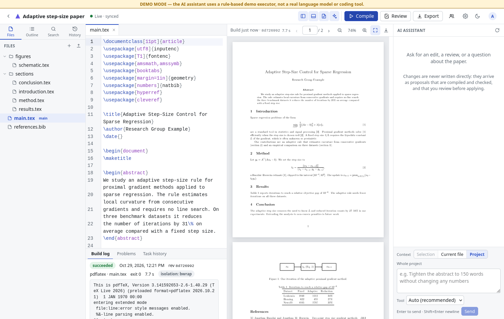

# Prism — a LaTeX paper-writing workspace for research labs

A browser-based paper-writing tool that runs on a lab server. One screen provides:

- LaTeX project and file management (create, ZIP import, upload, rename, delete, search, section outline)
- Official conference/preprint templates (ACL, CVPR/ICCV, NeurIPS 2025, ICML 2026, arXiv): downloaded from the publishers' own URLs when a project is created, never redistributed by Prism
- Bibliography: search arXiv and add BibTeX by arXiv id or DOI (entries are taken verbatim from arXiv / doi.org, duplicates detected)
- PDF <-> source jumps (SyncTeX): "Show in PDF" (or Ctrl+Alt+J) highlights the caret's line on the page; double-clicking the PDF opens the source file at that line, also in included files
- Bibliography verification: every `.bib` entry is looked up by DOI (doi.org), arXiv id (arXiv API) or title (Crossref, then OpenAlex) and marked verified / different work / not found; "not found" is a hint (books and non-English works are often missing)
- Zotero import: a library, group or collection (API key sent per request, never stored; public groups need none), merged into the `.bib` without duplicating works already there
- arXiv preflight (Check tab) and "arXiv source (.zip)" export with the `.bbl` of your last compile; rules are taken from arXiv's help pages
- Reviewer report (Roundtable dialog, "Independent reviews"): Codex, Claude Code and Antigravity each review the paper in parallel as separate, read-only reviewers (in their sandboxes; anything they write is discarded), optionally as a persona you type (e.g. "an ACL area chair"); the orchestrator LLM then merges the reviews into one report with agreements, disagreements and a prioritized improvement plan, and each tool's original review stays expandable. A tool that fails is shown as failed, never filled in
- **Roundtable** (AI panel header button; one dialog with your own prompt, goal [your prompt / review / strategy / experiment design / revision direction], rounds, role, participants, Korean, and a choice between a discussion and independent reviews only; participants and options sit side by side; a **Lead** can be chosen: the orchestrator LLM (default) or one of the tools writes the final report, and if the tool cannot, the LLM writes it and the result says so); the role you give the participants is shown in the request and kept with the result): the same tools discuss the manuscript. Round 1 is independent; from round 2 each tool reads the others' latest statements (treated as untrusted text), answers them and ends with `STATUS: AGREE/DISAGREE` (3 to 5 rounds in the dialog, default 3; it stops early when everyone agrees). Topic: manuscript review, revision direction, overall paper strategy (positioning, storyline, missing evidence, order of work), or experiment design (protocols: arms, sample size, procedure, metrics, analysis, decision rule, cost). A free-text field tells every tool and the moderator what to work on; the optional role only sets who they act as. An experiment-design discussion writes one complete protocol per experiment plus a summary table (values the manuscript does not fix are marked PROPOSED). A strategy discussion produces one integrated FINAL DESIGN (experiments in execution order with go/no-go gates, contested points decided and marked as the moderator's recommendation, resources, risks) and, like experiment design, makes no edit proposal unless you tick it. A discussion message has a "Save as file" button that stores the report as `notes/<topic>-<time>.md` in the project (no manuscript file is touched). Everything the tools do is read-only; the orchestrator LLM moderates (summary, a FINAL CONCLUSION that decides every contested point, marks the decision as the moderator's recommendation and ends in prioritised actions, then consensus, disagreements and dropped points; the moderator's own recommendations never become the edit proposal) and the list of changes ALL active participants accepted can become one proposal through the usual delegation, verification and apply flow. Nothing agreed means no proposal. A tool that fails leaves the discussion and is shown as such. Costs one run per tool per round When the request is written in Korean, or the AI panel's "Also answer in Korean (한국어)" box is ticked (default for a Korean browser; it also covers chat, analysis presets and the Reviewer report, which gets a "7. 한국어" section), the report ends with a faithful Korean version of the same decisions (`## 한국어`); it is placed before the agreed changes so it never becomes part of the edit proposal. Tools can address each other with `@Codex`, `@Claude Code` or `@Antigravity`: the addressed tool is shown the line first in the next round. Agreement has to be earned (each accepted point needs something of the tool's own; a reply that mostly repeats another tool's statement is flagged as an echo and the moderator treats it as weak support), an optional devil's advocate (the last selected tool) must state its strongest evidence-based objection before accepting a point, and the report has a "FOR YOUR DECISION" section for points raised by one participant only or too late to be answered; those never become agreed changes.
- Prompt templates in the Roundtable dialog (terminology consistency, missing citations) fill the prompt box; they run as a tool discussion (the earlier answer-only preset buttons were removed)
- Compile any `.tex` file: Compile builds the open file and names the PDF after it (a section file without `\documentclass` builds the main file instead); a switch makes it always build the main file
- Drag and drop: drop files or whole folders onto the file panel or onto a folder to upload them; an upload never replaces a file silently: files whose names already exist are collected and one dialog asks to replace or keep them (each replaced file is first saved in the project history)
- Ask AI about a selection: select text in the editor and press "Ask AI about selection"; the selected lines become the AI request's context
- Failed builds: a missing TeX package (`File 'x.sty' not found`) or font metric (`failed to make x.tfm`, `Metric (TFM) file not found`) is installed automatically and the paper rebuilt (`tlmgr`, official TeX Live repository only, at most 5 packages per build; switches `TEX_PACKAGE_AUTO_INSTALL`, `ALLOW_TEX_PACKAGE_INSTALL`), with a one-click button as the fallback; other LaTeX errors offer "Fix with AI", which creates an ordinary reviewed task
- Planning speed: the orchestrator model's hidden reasoning is switched off first for plain answers/edits without external tools (`llm` mode; 2-4x faster in comparison runs) and stays on for analyses, delegation and tool choice; an invalid quick plan is repaired with reasoning on. `LLM_PLANNING_THINKING=auto|on|off`
- Chat memory: each request is planned with your recent chat in the project (your requests and the answers; at most 10 messages / 9,000 characters, secrets removed, never other users' chat), so follow-ups like "were the points you raised fixed?" work. Standalone analysis presets are planned without it
- Copy buttons in the AI Assistant: every message and every tool's original review can be copied exactly as shown; if the browser refuses the clipboard the button says "Copy failed" instead of pretending
- **PDF page count for the AI**: each compile records the PDF's page count (from TeX's own log, else `pdfinfo`). The planner and external tools are told the latest count and whether the text changed since; proposal verification shows base → candidate pages. If no count exists the AI is told to say so instead of guessing.
- **Page-limit estimate**: if a request names a limit ("8 pages", "8페이지"), the AI is told roughly how many text lines sit beyond it (from `pdftotext` per page, page numbers excluded). It is labelled an estimate: figures, tables and float placement are not counted. The verification report shows the last page's text lines base → candidate.
- **Retry until the page limit is met**: when a request names a page limit, the candidate is compiled; if it is still over, the same executor (qwen's own edit or the chosen tool) is asked again with the measured overflow, up to `PAGE_LIMIT_RETRIES` (default 2, 0 = off). The result says plainly whether the limit was confirmed met; a candidate that is still over is shown as such, not claimed.
- **Long sections in the AI context**: a section (or an unsectioned file) longer than the context budget is cut into pieces of about 5,000 characters instead of being dropped whole, the pieces matching the request come first, and when anything is left out the model is told so. `LLM_CONTEXT_CHARS` (default 24000) still decides how much of a long paper the model sees; the orchestrator model accepts far more, so raise it for long manuscripts (the production setup uses 400000; see `docs/verification.md` for what was and was not tested).
- **Web search and page reading for the AI** (`WEB_ACCESS_ENABLED`, off by default): the orchestrator can ask for up to 3 searches and 3 public pages per turn (default 3 rounds); the server runs them and returns the text marked as untrusted third-party data, to be cited with its URL and never obeyed. Only public http(s) addresses on ports 80/443 are fetched (loopback, private, tailnet and link-local addresses are refused, also after redirects); size, time and text length are capped; PDFs are read with `pdftotext`. Search uses a SearXNG instance if `WEB_SEARCH_URL` is set, else DuckDuckGo with Bing as fallback (keyless HTML scraping, can be blocked). Not used by analysis presets or when you pick a tool yourself
- **Word count for the AI**: every request's context includes a `texcount` word count (text, headings, captions; follows `\input`), and a request naming a limit ("8,000 words", "5000단어") gets the gap. It is an estimate: math and the bibliography are not counted and a journal may count differently. If `texcount` is unavailable the AI is told the count is unknown
- **Changes-marked PDF** (`latexdiff`): on a proposal's PDF tab, "Show changes marked" compiles the base and candidate text through `latexdiff` (additions blue and underlined, deletions red and struck out) in the normal sandboxed compiler and caches the result. `\input` files are inlined from the project's own files only (not `latexdiff --flatten`, which reads any server path). Needs `latexdiff` and the `ulem` package The proposal card in the AI chat has a **Preview PDF** button that opens the same compiled candidate PDF (and the changes-marked version) over the chat, so a proposal can be judged on the typeset result before anything is applied.
- **Tidy (latexindent)**: the editor's "Tidy" button re-indents the saved `.tex` file with `latexindent` and opens the result as a proposal (diff, verification, explicit apply); nothing is written until you apply. The file is formatted in an empty temporary directory with a temporary HOME, so no project or user latexindent settings are read. Needs `latexindent` and its Perl modules (`scripts/install-latexindent-deps.sh`)
- One-click apply: proposals in the AI chat have an Apply button (verified proposals only), and the Review page applies with a single click
- Auto compile (opt-in, off by default): compiles a few seconds after you stop editing; a failing text is tried once, not in a loop
- AI autocomplete (opt-in, off by default): greyed inline suggestion at the end of a line after a pause, Tab accepts, Esc dismisses; uses the orchestrator LLM, one request per user at a time
- Manuscript check (no AI): undefined citations/references, duplicate labels and keys, missing figures and inputs, TODO markers, each linked to its line; plus `chktex` typography/syntax hints (shown as info, hidden until you ask for them; needs `chktex` in the TeX bin directory)
- LaTeX/BibTeX editor (CodeMirror 6: syntax highlighting, find/replace, jump to error location, autosave)
- Preview of the real compiled PDF (TeX Live + latexmk, bubblewrap isolation, rendered with pdf.js)
- AI chat with the paper as context. An **orchestrator LLM** on a separate inference server (e.g. a5000) analyses each request and, when needed, automatically calls the Codex / Claude Code / Antigravity CLIs **Attach files** (paperclip next to the request box, up to 10): they are saved in the project under `attachments/` (never over an existing file; a taken name gets a prefix), named in the request, and the text of text files (up to 30,000 characters each, cut with a notice) goes into the orchestrator's context; binaries are only named, so an external tool has to open them. No manuscript file is changed.
- Review of AI changes: diff, verification report, candidate PDF, apply all or part, conflict resolution; on a conflicted proposal "Redo on the current manuscript" re-runs the original request against the current text as a new task (the old proposal stays until you reject it)
- Version history (Git), named versions, version restore (as a reviewed proposal), ZIP/PDF export
- Real-time collaborative editing by several researchers (Yjs) with roles (owner / editor / viewer)

> The design document `Local_Research_Workspace_Design.md` mentioned as an attachment could not be found in the working environment (a full filesystem search returned nothing). The implementation follows the request prompt and the later design change (orchestrator LLM moved to a separate server, `LLM_*` settings).



## Components

| Component | Technology | Location |
|---|---|---|
| Web/API | Python 3.12, FastAPI, SQLAlchemy, Alembic | `backend/app` |
| Worker | Same codebase, `python -m app.worker`; compiles, proposal verify/apply and AI tasks run in separate threads, and every project has its own queue per kind (one project's jobs run in order, other projects are not held up; `WORKER_*_SLOTS` cap how many run at once) | `backend/app/worker.py` |
| DB / job queue | PostgreSQL 17 (`FOR UPDATE SKIP LOCKED` queue). SQLite supported for development | `backend/migrations` |
| Compilation | TeX Live + latexmk, bubblewrap sandbox | `backend/app/compile` |
| Orchestrator LLM | OpenAI-compatible API client (provider adapter design) | `backend/app/llm` |
| Tool adapters | `codex exec`, `claude -p`, `agy -p` | `backend/app/adapters` |
| Collaboration | Node + Yjs (y-protocols), persistent storage | `collab/server.mjs` |
| Frontend | React 18 + TypeScript + Vite, CodeMirror 6, pdf.js | `frontend/` |
| Deployment | Docker Compose + nginx | `docker-compose.yml`, `deploy/` |

Choices that differ from the suggested stack (a PostgreSQL queue instead of Redis, bubblewrap inside the worker container instead of a container per build) and the reasons for them are in [docs/architecture.md](docs/architecture.md).

## Quick start (development)

Requires `uv`, Node 20+ (npm), `git`, `bubblewrap`, and TeX Live (`latexmk`). No sudo needed (this repository was developed and verified on a server without sudo; installation notes in [docs/deployment.md](docs/deployment.md)).

```bash
make install                 # backend (uv sync), frontend (npm ci), collab (npm ci)
cp .env.example .env         # for development, delete the DATABASE_URL line to use SQLite (var/prism.db)
#   fill in PRISM_ADMIN_USERNAME / PRISM_ADMIN_PASSWORD to create an admin on first start
#   with COLLAB_ENABLED=true, dev.sh also starts the collaboration service
make dev                     # API :8000, worker, collab :1234, Vite :5173
```

Browser: **http://localhost:5173** (Vite proxies `/api` and `/collab`)

## Running on a server

### Docker Compose (recommended for production)

```bash
cp .env.example .env         # set PRISM_SECRET_KEY, PRISM_ADMIN_*, COLLAB_SHARED_SECRET, LLM_*
export POSTGRES_PASSWORD=...  # or add it to .env
docker compose build
docker compose up -d
```

Browser: **http://<server>:8080** (change with `PRISM_HTTP_PORT`). When exposing it beyond the lab, put a TLS reverse proxy in front and set `PRISM_COOKIE_SECURE=true`. Service layout and network isolation: [docs/deployment.md](docs/deployment.md).

> This development host has no Docker, so the Compose setup has **not been verified by running it** (only its YAML structure was checked). The Docker-free method below has been verified for real.

### Without Docker

```bash
cd frontend && npm ci && npm run build && cd ..
./scripts/serve.sh           # needs .env. web (0.0.0.0:8000) + worker + collab
```

Browser: **http://<server>:8000**. The collaboration WebSocket is proxied over the same port (`/collab`), so port 1234 does not need to be exposed.

### Access over Tailscale (tailnet only)

The web process proxies the collaboration WebSocket at `/collab` on the same port (leave `COLLAB_PUBLIC_URL` empty), so a single port is enough. Nothing is exposed on public or LAN interfaces in either setup below.

**HTTPS without a port (recommended; used by the current deployment)**: Prism listens only on localhost and Tailscale terminates TLS with a tailnet certificate.

1. In the Tailscale admin console, enable MagicDNS and HTTPS certificates (DNS page).
2. Let your user manage Tailscale serve, once (needs sudo): `sudo tailscale set --operator=$USER`
3. In `.env`: `PRISM_HOST=127.0.0.1`, `PRISM_COOKIE_SECURE=true`; restart `prism-web prism-collab prism-worker`.
4. `tailscale serve --bg --https 443 http://127.0.0.1:8000` (persists across reboots; check with `tailscale serve status`, remove with `tailscale serve --https=443 off`).

- Address: `https://<machine>.<tailnet>.ts.net/`
- With secure cookies, plain-HTTP addresses cannot log in, so do not also expose an HTTP port.

**Plain HTTP on a port (no sudo)**: with `PRISM_HOST=tailscale`, `serve.sh` and the systemd services bind only to this node's Tailscale IPv4 address. Address: `http://<machine>.<tailnet>.ts.net:8000` (keep `PRISM_COOKIE_SECURE=false`). Ports below 1024 such as 80 need root, so the port stays in the URL.

### Always-on systemd services (no root needed)

```bash
loginctl enable-linger $USER          # keep services running without a login session (once)
./scripts/install-systemd.sh          # prism-db (optional) / collab / web / worker + daily 03:30 backup timer
systemctl --user start prism-db prism-collab prism-web prism-worker prism-backup.timer
systemctl --user status 'prism-*'     # status
journalctl --user -u prism-web -f     # logs
```

If `PRISM_PG_DATA`/`PRISM_PG_BIN` are set, PostgreSQL is managed as the `prism-db` service as well. After changing settings, run `systemctl --user restart prism-web prism-worker`.

Admin commands:

```bash
cd backend
uv run python -m app.cli create-user alice --admin   # password from prompt/stdin
uv run python -m app.cli doctor                      # TeX, sandbox, LLM settings, collab, tool status
uv run python -m app.cli llm-test                    # orchestrator LLM connection test (JSON output)
uv run python -m app.cli tools                       # tool installation/authentication status
```

## Connecting the orchestrator LLM (separate inference server such as a5000)

No model is installed on the web server. Only the backend calls the inference API; browsers never reach the LLM server directly. The existing LLM server's runtime configuration is left unchanged.

```ini
LLM_PROVIDER=openai          # OpenAI-compatible /v1/chat/completions (vLLM, SGLang, llama.cpp server, LM Studio …)
LLM_BASE_URL=http://<address reachable from the web server>:<port>/v1
LLM_MODEL=<exact model id listed by GET /v1/models>
LLM_API_KEY=<if required>
LLM_CONTEXT_CHARS=24000      # adjust to the context window of the model actually being served
```

Port, model id, API format and context length are never guessed from the server name (for the deployment, the endpoint and model id were taken from the running server on a5000 and its `GET /v1/models` list). For an API that is not OpenAI-compatible, implement `LLMProvider` in `backend/app/llm/provider.py` and register it in `PROVIDERS`.

**Backup LLM and load balancer.** `LLM_BASE_URL` can point at a load balancer instead of one server (for example a LiteLLM router that spreads one model name over several vLLM servers and retries; its master key goes in `LLM_API_KEY`). Set `LLM_CONTEXT_CHARS` for the *smallest* context window behind it, because any request may land on that server. Independently of that, `LLM_FALLBACK_BASE_URL` / `LLM_FALLBACK_MODEL` / `LLM_FALLBACK_API_KEY` / `LLM_FALLBACK_CONTEXT_CHARS` name a backup that is used only while the primary does not answer at all (probe `GET <base>/models`, 3 s connect, cached 30 s; a slow primary is not failed over). A request that reaches the primary but fails with a connection error or HTTP 502/503/504 (a balancer that answers `/models` but cannot serve chat) is repeated once on the backup and the primary is treated as down for 120 s; a streamed reply fails over only before its first piece; timeouts and other HTTP errors (400, 401, 429, 500) are shown as errors, not failed over. While the backup is active, planning uses JSON-in-prompt mode, the context budget is the backup's, autocomplete uses the backup model, and *Settings* shows `fallback.in_use` without the backup's address. When a server is only reachable over SSH (bound to localhost), run the tunnel as a user service, e.g. `ssh -N -L 127.0.0.1:<local port>:127.0.0.1:<remote port> <ssh host alias>` with `Restart=always` and `BatchMode=yes`, and point the URL at `http://127.0.0.1:<local port>/v1`. Real host names and addresses belong only in `.env` and the local unit, never in the repository. Things found while running behind a LiteLLM router: (1) the router has its own request timeout, and a long generation (a discussion report is up to 8,000–14,000 output tokens) on a slow server is cut with HTTP 408 and retried, so raise the router's timeout together with `LLM_TIMEOUT_SECONDS`; (2) with `least-busy` routing and `allowed_fails: 3`, a server that fails instantly always looks idle and keeps being chosen (HTTP 502 while it is down), so use `simple-shuffle` and `allowed_fails: 1`; (3) a 502/503/504 from the balancer triggers the backup, other HTTP errors do not. Mixed fast and slow servers make report times vary a lot.

**Settings → Orchestrator LLM → Test connection** (or `app.cli llm-test`) actually checks:

1. Whether the API is reachable from the web backend (distinguishing DNS failure / connection refused / TLS / authentication errors)
2. The model list the server offers and whether `LLM_MODEL` matches it (context length is shown if the server reports it)
3. Normal and streaming responses
4. Support for tool calling and for JSON output (`json_object` / `json_schema`)
5. Timeout handling (a 50 ms budget on a long generation request → a clean `timeout` error)

The result is stored, and with `LLM_PLANNING_MODE=auto` the planning method (tool calling → JSON mode → JSON in the prompt + server-side validation) is chosen according to the **observed capabilities**.

## Installing and authenticating the external CLIs

Each tool uses a dedicated service home directory (default `<PRISM_DATA_DIR>/tool-homes/<tool>`). Settings and credentials from users' personal home directories are not used.

| Tool | Install | Authentication (either one) |
|---|---|---|
| Codex | `npm install -g @openai/codex` | `CODEX_HOME=<data>/tool-homes/codex/.codex codex login` or `CODEX_OPENAI_API_KEY` |
| Claude Code | `npm install -g @anthropic-ai/claude-code` (or the official install script) | `CLAUDE_CONFIG_DIR=<data>/tool-homes/claude/.claude claude auth login`, or `CLAUDE_ANTHROPIC_API_KEY` (then run with `--bare`) |
| Antigravity | Per the [official documentation](https://antigravity.google/docs) | Log in interactively once with `HOME=<data>/tool-homes/antigravity agy`, or `AGY_GEMINI_API_KEY` |

Check status under **Settings → Tools** (installed / version / authentication / `--help` flag compatibility). Details: [docs/agent-adapters.md](docs/agent-adapters.md).

## Real service vs. DEMO mode

| | Real service | `DEMO_MODE=true` |
|---|---|---|
| Orchestration | Configured LLM | Rule-based planning when no LLM is configured (questions are answered with an explicit "cannot answer") |
| Executors | Codex / Claude Code / Antigravity | Plus a `demo` executor: a real subprocess, but a fixed edit with no AI that inserts one labelled comment line |
| Labelling | — | Banner at the top of every screen, `DEMO` tag on tasks and proposals |

Compilation, verification, diff, apply and collaborative editing all work for real in DEMO mode too. Do not enable it on a production instance.

## Where data is stored, and backups

- DB: PostgreSQL (users, projects, build/task/proposal metadata, job queue, events)
- `PRISM_DATA_DIR/projects/<id>/repo`: current manuscript working tree + `.git` history
- `PRISM_DATA_DIR/builds/<id>/output.pdf`: build PDFs (the latest 10 per project + the last successful one are kept)
- `PRISM_DATA_DIR/proposals/<id>/{base,candidate}`: files before/after a proposal
- `PRISM_DATA_DIR/tasks/<id>/attempt-N/{work,run}`: tool working copies and logs
- `PRISM_DATA_DIR/tool-homes/`: per-tool login data (secret — handle backups with care)
- `COLLAB_DATA_DIR/<id>.ystate`: collaborative document state

```bash
./scripts/backup.sh [target dir]     # pg_dump (or SQLite backup) + data + collab, with SHA256SUMS
./scripts/restore.sh <backup dir>    # run with the services stopped
```

## Implementation status

Implemented and verified (evidence in [docs/verification.md](docs/verification.md)):

- Project home, workspace, change review and settings screens (light/dark, tabbed layout on narrow screens with a one-row header, finger-sized touch targets and a folded AI toolbox; resizable/collapsible panels). The app icon is a prism splitting a beam into a spectrum (`frontend/icons-src/make_icons.py` redraws it). Installable as an app (PWA: manifest, icons, a service worker that caches nothing, so there is no offline mode); HTTPS is needed for the install prompt
- Safe ZIP import, per-project permissions, CSRF protection
- Isolated real LaTeX compilation, last successful PDF kept on failure, stale indicator
- Orchestrator LLM client, 5-step connection test, schema validation and re-prompting, direct answers / direct edit proposals / delegation to external tools
- Three tool adapters, automatic selection policy, limits of 2 attempts, 10 minutes per run and 25 minutes overall, cancel/retry, allowed-scope checks, recursive delegation blocked
- Proposal verification (compile + citation/label/number/equation report), conditional apply, 3-way merge followed by re-verification, conflict resolution, partial (hunk) apply followed by re-verification
- Real-time collaborative editing (two clients editing at once, AI changes propagated, read-only viewers, reconnect, state restored after restart)
- Saving, comparing and restoring versions, ZIP/PDF export, backup and restore scripts
- Official templates (all five download, import and compile for real in the sandbox), arXiv search, BibTeX import by arXiv id / DOI (arXiv BibTeX and doi.org checked against the live services), manuscript check, AI autocomplete (real a5000 answers in ~0.6 s with thinking disabled; browser-checked)
- Page limits: each compile records the PDF page count and the text lines per page; a request that names a limit gets the measured overflow as an estimate, and the candidate is recompiled and retried up to `PAGE_LIMIT_RETRIES` times (real pdflatex tests, plus real a5000 runs: 13 → 12 pages and 12 → 11 pages reached the limit)
- Web access and word count: with `WEB_ACCESS_ENABLED=true` the orchestrator searched the web and read a public PDF on prod with the real a5000 model and answered a journal-guideline question with a quoted source (one question; the quote was not checked by hand); address blocking and result parsing are covered by fake-network tests; `texcount` word counts are measured and passed to the model
- Long manuscripts in the AI context: over-long sections are cut into pieces instead of dropped, and the model is told when text was left out (production `LLM_CONTEXT_CHARS=400000`; a 150-page synthetic document was planned without a timeout)
- Solo mode: with `COLLAB_ENABLED=false` an external `git push` into a project repository (`receive.denyCurrentBranch=updateInstead`) is compiled directly, without Restore → proposal → Apply; `install-systemd.sh` then installs and starts no collab service. Checked with a temporary project on the production worker

Remaining work / not verified:

- **Orchestrator LLM**: connected to the a5000 server (vLLM, Qwen3.8-27B-FP8, served id `qwen38-a5000`). All 7 connection-test steps pass and a real Auto question was answered correctly from the project. The real model also planned and delegated edit tasks to each external tool (below). The real model has also written edit proposals itself (the page-limit runs).
- **External tools**: Codex 0.165.0 and Claude Code 2.1.312 are signed in separately in the service tool homes; Antigravity (agy) 1.4.10 is signed in separately for Prism (its token differs from the personal one). A real edit task with each of the three, inside the bwrap sandbox, produced a proposal; Antigravity was re-run with its own login (86 s, one file changed, proposal ready). Antigravity needs a CPU with PCLMUL (a generic QEMU CPU model is not enough).
- **Auto mode with the real LLM**: observed end to end — the model edited directly for a small request, and delegated a file-restructuring request, for which Auto picked Codex (and Claude Code when it was first in the project's order); the verification caught a real problem (Claude Code cannot delete files, so equations ended up duplicated). Planning time varies from under a minute to over ten (shared a5000; `LLM_TIMEOUT_SECONDS=600`), and one run failed on that timeout. **Not observed with real tools: the fallback to the next tool after a failure** (covered by fake-CLI tests only).
- **arXiv search** parsing is tested against a response with the real structure; a live search was blocked by arXiv rate limiting (HTTP 429) when tested.
- **Page limits, long context and solo mode**, not verified: retries with a real external tool (only qwen's own edits and a fake CLI were used); documents with figures, tables or many floats (the line estimate ignores them and can be wrong either way); the 400000-character context on real LaTeX/Korean text (tokens per character are higher than in the synthetic English-like text, so the model's 262144-token window could be reached sooner) and its planning time on its own; a `git push` while the project working tree has uncommitted web edits (`updateInstead` should refuse it) and two people editing one file in solo mode; the state after a reboot. In the 400000-character run the final message was the server's plain summary, not the model's explanation, and the reason was not investigated. Details: `docs/verification.md`.
- **Changes-marked PDF**, partly verified: the button was clicked in Firefox on a separate DEMO stack (`e2e/discussui.mjs`: it builds, the plain/marked toggle appears, `GET` returns a PDF); the marked PDF was only seen for a whitespace-only (tidy) proposal, so blue/red markup on real edits was not looked at in the browser; only text changes were tried (not figures, tables or equation edits, where latexdiff markup can break compilation); the build is synchronous and was not timed on a large paper; a viewer cannot build it (editors can) but can open one that exists.
- **Tidy**, partly verified: the button was clicked in Firefox on the DEMO stack and opened the tidy proposal with its diff; unsaved editor text is not tidied (the saved file is); only the JAMS manuscript and a small sample were tried; latexindent can change verbatim-like or comment layout in unusual documents, which the diff shows but no check enforces.
- **Web access and word count**, not verified: only one real web question was run; a word-limit request was run twice with qwen editing directly and failed twice (empty `edit`), and once in Auto mode where an external tool reached 3,960 of 4,000 words; unlike pages, the word limit is not re-checked or retried by the server; the search engines are scraped without a key and can block (DuckDuckGo already did); a real "reduce to N words" request; `latexindent` (needs Perl modules) does not run and `chktex`/`latexdiff` are installed but not connected.
- **Docker Compose**: no Docker on this host, so image builds and startup were not verified.
- Backup script: the `pg_dump` backup path was run on the production PostgreSQL instance; the `pg_restore` path of `restore.sh` has not been run. The SQLite backup/restore path was verified.
- The memory cap for tool processes relies on the container (`mem_limit`) (Node-based CLIs are incompatible with `RLIMIT_AS`).
- AI chat history is per user (task history is shared within the project). "New chat" (AI panel header) starts a new conversation: the chat is emptied and the AI no longer sees the earlier one as context, but nothing is deleted (tasks, proposals and old messages stay) and there is no screen to bring the old chat back.

## Documentation

- [docs/architecture.md](docs/architecture.md) — components, data flow, security boundaries, reasons for design choices
- [docs/deployment.md](docs/deployment.md) — installation, Compose, network, TLS, operations
- [docs/agent-adapters.md](docs/agent-adapters.md) — orchestrator LLM, task contract, per-tool flags, events and authentication
- [docs/verification.md](docs/verification.md) — checks actually performed and their results
