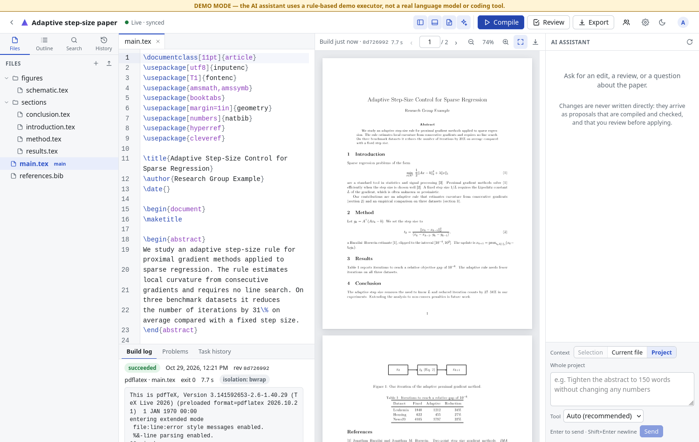

# Prism — a LaTeX paper-writing workspace for research labs

A browser-based paper-writing tool that runs on a lab server. One screen provides:

- LaTeX project and file management (create, ZIP import, upload, rename, delete, search, section outline)
- LaTeX/BibTeX editor (CodeMirror 6: syntax highlighting, find/replace, jump to error location, autosave)
- Preview of the real compiled PDF (TeX Live + latexmk, bubblewrap isolation, rendered with pdf.js)
- AI chat with the paper as context. An **orchestrator LLM** on a separate inference server (e.g. a5000) analyses each request and, when needed, automatically calls the Codex / Claude Code / Antigravity CLIs
- Review of AI changes: diff, verification report, candidate PDF, apply all or part, conflict resolution
- Version history (Git), named versions, version restore (as a reviewed proposal), ZIP/PDF export
- Real-time collaborative editing by several researchers (Yjs) with roles (owner / editor / viewer)

> The design document `Local_Research_Workspace_Design.md` mentioned as an attachment could not be found in the working environment (a full filesystem search returned nothing). The implementation follows the request prompt and the later design change (orchestrator LLM moved to a separate server, `LLM_*` settings).



## Components

| Component | Technology | Location |
|---|---|---|
| Web/API | Python 3.12, FastAPI, SQLAlchemy, Alembic | `backend/app` |
| Worker | Same codebase, `python -m app.worker` | `backend/app/worker.py` |
| DB / job queue | PostgreSQL 17 (`FOR UPDATE SKIP LOCKED` queue). SQLite supported for development | `backend/migrations` |
| Compilation | TeX Live + latexmk, bubblewrap sandbox | `backend/app/compile` |
| Orchestrator LLM | OpenAI-compatible API client (provider adapter design) | `backend/app/llm` |
| Tool adapters | `codex exec`, `claude -p`, `agy -p` | `backend/app/adapters` |
| Collaboration | Node + Yjs (y-protocols), persistent storage | `collab/server.mjs` |
| Frontend | React 18 + TypeScript + Vite, CodeMirror 6, pdf.js | `frontend/` |
| Deployment | Docker Compose + nginx | `docker-compose.yml`, `deploy/` |

Choices that differ from the suggested stack (a PostgreSQL queue instead of Redis, bubblewrap inside the worker container instead of a container per build) and the reasons for them are in [docs/architecture.md](docs/architecture.md).

## Quick start (development)

Requires `uv`, Node 20+ (npm), `git`, `bubblewrap`, and TeX Live (`latexmk`). No sudo needed (this repository was developed and verified on a server without sudo; installation notes in [docs/deployment.md](docs/deployment.md)).

```bash
make install                 # backend (uv sync), frontend (npm ci), collab (npm ci)
cp .env.example .env         # for development, delete the DATABASE_URL line to use SQLite (var/prism.db)
#   fill in PRISM_ADMIN_USERNAME / PRISM_ADMIN_PASSWORD to create an admin on first start
#   with COLLAB_ENABLED=true, dev.sh also starts the collaboration service
make dev                     # API :8000, worker, collab :1234, Vite :5173
```

Browser: **http://localhost:5173** (Vite proxies `/api` and `/collab`)

## Running on a server

### Docker Compose (recommended for production)

```bash
cp .env.example .env         # set PRISM_SECRET_KEY, PRISM_ADMIN_*, COLLAB_SHARED_SECRET, LLM_*
export POSTGRES_PASSWORD=...  # or add it to .env
docker compose build
docker compose up -d
```

Browser: **http://<server>:8080** (change with `PRISM_HTTP_PORT`). When exposing it beyond the lab, put a TLS reverse proxy in front and set `PRISM_COOKIE_SECURE=true`. Service layout and network isolation: [docs/deployment.md](docs/deployment.md).

> This development host has no Docker, so the Compose setup has **not been verified by running it** (only its YAML structure was checked). The Docker-free method below has been verified for real.

### Without Docker

```bash
cd frontend && npm ci && npm run build && cd ..
./scripts/serve.sh           # needs .env. web (0.0.0.0:8000) + worker + collab
```

Browser: **http://<server>:8000**. The collaboration WebSocket is proxied over the same port (`/collab`), so port 1234 does not need to be exposed.

### Access over Tailscale (tailnet only)

With `PRISM_HOST=tailscale` in `.env`, `serve.sh` and the systemd services bind only to this node's Tailscale IPv4 address. Nothing listens on public or LAN interfaces. The web process proxies the collaboration WebSocket at `/collab` on the same port (leave `COLLAB_PUBLIC_URL` empty), so a single port is enough.

- Address: `http://<machine>.<tailnet>.ts.net:8000`
- For HTTPS, enable HTTPS certificates for the tailnet, run `sudo tailscale set --operator=$USER` once, then use `tailscale serve --bg 8000` (in that case set `PRISM_HOST=127.0.0.1` and `PRISM_COOKIE_SECURE=true`).

### Always-on systemd services (no root needed)

```bash
loginctl enable-linger $USER          # keep services running without a login session (once)
./scripts/install-systemd.sh          # prism-db (optional) / collab / web / worker + daily 03:30 backup timer
systemctl --user start prism-db prism-collab prism-web prism-worker prism-backup.timer
systemctl --user status 'prism-*'     # status
journalctl --user -u prism-web -f     # logs
```

If `PRISM_PG_DATA`/`PRISM_PG_BIN` are set, PostgreSQL is managed as the `prism-db` service as well. After changing settings, run `systemctl --user restart prism-web prism-worker`.

Admin commands:

```bash
cd backend
uv run python -m app.cli create-user alice --admin   # password from prompt/stdin
uv run python -m app.cli doctor                      # TeX, sandbox, LLM settings, collab, tool status
uv run python -m app.cli llm-test                    # orchestrator LLM connection test (JSON output)
uv run python -m app.cli tools                       # tool installation/authentication status
```

## Connecting the orchestrator LLM (separate inference server such as a5000)

No model is installed on the web server. Only the backend calls the inference API; browsers never reach the LLM server directly. The existing LLM server's runtime configuration is left unchanged.

```ini
LLM_PROVIDER=openai          # OpenAI-compatible /v1/chat/completions (vLLM, SGLang, llama.cpp server, LM Studio …)
LLM_BASE_URL=http://<address reachable from the web server>:<port>/v1
LLM_MODEL=<exact model id listed by GET /v1/models>
LLM_API_KEY=<if required>
LLM_CONTEXT_CHARS=24000      # adjust to the context window of the model actually being served
```

Port, model id, API format and context length are never guessed from the server name (`a5000` did not even resolve from this development host). For an API that is not OpenAI-compatible, implement `LLMProvider` in `backend/app/llm/provider.py` and register it in `PROVIDERS`.

**Settings → Orchestrator LLM → Test connection** (or `app.cli llm-test`) actually checks:

1. Whether the API is reachable from the web backend (distinguishing DNS failure / connection refused / TLS / authentication errors)
2. The model list the server offers and whether `LLM_MODEL` matches it (context length is shown if the server reports it)
3. Normal and streaming responses
4. Support for tool calling and for JSON output (`json_object` / `json_schema`)
5. Timeout handling (a 50 ms budget on a long generation request → a clean `timeout` error)

The result is stored, and with `LLM_PLANNING_MODE=auto` the planning method (tool calling → JSON mode → JSON in the prompt + server-side validation) is chosen according to the **observed capabilities**.

## Installing and authenticating the external CLIs

Each tool uses a dedicated service home directory (default `<PRISM_DATA_DIR>/tool-homes/<tool>`). Settings and credentials from users' personal home directories are not used.

| Tool | Install | Authentication (either one) |
|---|---|---|
| Codex | `npm install -g @openai/codex` | `CODEX_HOME=<data>/tool-homes/codex/.codex codex login` or `CODEX_OPENAI_API_KEY` |
| Claude Code | `npm install -g @anthropic-ai/claude-code` (or the official install script) | `CLAUDE_CONFIG_DIR=<data>/tool-homes/claude/.claude claude auth login`, or `CLAUDE_ANTHROPIC_API_KEY` (then run with `--bare`) |
| Antigravity | Per the [official documentation](https://antigravity.google/docs) | Log in interactively once with `HOME=<data>/tool-homes/antigravity agy`, or `AGY_GEMINI_API_KEY` |

Check status under **Settings → Tools** (installed / version / authentication / `--help` flag compatibility). Details: [docs/agent-adapters.md](docs/agent-adapters.md).

## Real service vs. DEMO mode

| | Real service | `DEMO_MODE=true` |
|---|---|---|
| Orchestration | Configured LLM | Rule-based planning when no LLM is configured (questions are answered with an explicit "cannot answer") |
| Executors | Codex / Claude Code / Antigravity | Plus a `demo` executor: a real subprocess, but a fixed edit with no AI that inserts one labelled comment line |
| Labelling | — | Banner at the top of every screen, `DEMO` tag on tasks and proposals |

Compilation, verification, diff, apply and collaborative editing all work for real in DEMO mode too. Do not enable it on a production instance.

## Where data is stored, and backups

- DB: PostgreSQL (users, projects, build/task/proposal metadata, job queue, events)
- `PRISM_DATA_DIR/projects/<id>/repo`: current manuscript working tree + `.git` history
- `PRISM_DATA_DIR/builds/<id>/output.pdf`: build PDFs (the latest 10 per project + the last successful one are kept)
- `PRISM_DATA_DIR/proposals/<id>/{base,candidate}`: files before/after a proposal
- `PRISM_DATA_DIR/tasks/<id>/attempt-N/{work,run}`: tool working copies and logs
- `PRISM_DATA_DIR/tool-homes/`: per-tool login data (secret — handle backups with care)
- `COLLAB_DATA_DIR/<id>.ystate`: collaborative document state

```bash
./scripts/backup.sh [target dir]     # pg_dump (or SQLite backup) + data + collab, with SHA256SUMS
./scripts/restore.sh <backup dir>    # run with the services stopped
```

## Implementation status

Implemented and verified (evidence in [docs/verification.md](docs/verification.md)):

- Project home, workspace, change review and settings screens (light/dark, tabbed layout on narrow screens, resizable/collapsible panels)
- Safe ZIP import, per-project permissions, CSRF protection
- Isolated real LaTeX compilation, last successful PDF kept on failure, stale indicator
- Orchestrator LLM client, 5-step connection test, schema validation and re-prompting, direct answers / direct edit proposals / delegation to external tools
- Three tool adapters, automatic selection policy, limits of 2 attempts, 10 minutes per run and 25 minutes overall, cancel/retry, allowed-scope checks, recursive delegation blocked
- Proposal verification (compile + citation/label/number/equation report), conditional apply, 3-way merge followed by re-verification, conflict resolution, partial (hunk) apply followed by re-verification
- Real-time collaborative editing (two clients editing at once, AI changes propagated, read-only viewers, reconnect, state restored after restart)
- Saving, comparing and restoring versions, ZIP/PDF export, backup and restore scripts

Remaining work / not verified:

- **Real orchestrator LLM connection**: the real `LLM_BASE_URL` and `LLM_MODEL` for a5000 were not provided, so no real model was tested (the client and validation logic were tested against a fake OpenAI-compatible server).
- **Tool authentication**: for Codex and Claude Code, installation, flags, sandboxed execution and detection of the unauthenticated state were checked with the real CLIs; running real authenticated tasks needs service credentials. The Antigravity CLI is not present on this host, so its adapter follows the official documentation and has not been run.
- **Docker Compose**: no Docker on this host, so image builds and startup were not verified.
- Backup script: the `pg_dump` backup path was run on the production PostgreSQL instance; the `pg_restore` path of `restore.sh` has not been run. The SQLite backup/restore path was verified.
- The memory cap for tool processes relies on the container (`mem_limit`) (Node-based CLIs are incompatible with `RLIMIT_AS`).
- AI chat history is per user (task history is shared within the project).

## Documentation

- [docs/architecture.md](docs/architecture.md) — components, data flow, security boundaries, reasons for design choices
- [docs/deployment.md](docs/deployment.md) — installation, Compose, network, TLS, operations
- [docs/agent-adapters.md](docs/agent-adapters.md) — orchestrator LLM, task contract, per-tool flags, events and authentication
- [docs/verification.md](docs/verification.md) — checks actually performed and their results
