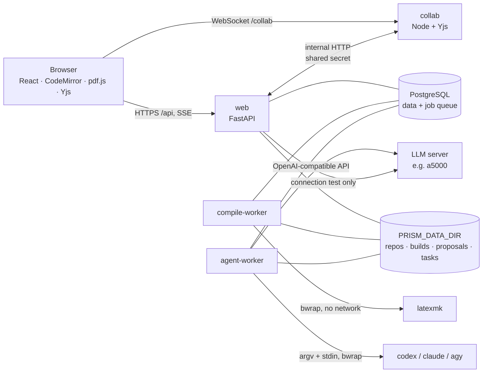

# Architecture

## Processes



* **web** serves the API and the built frontend. It never compiles, never runs agent CLIs and has no Docker socket.
* **workers** claim jobs from the `jobs` table: `compile`, `agent`, `verify_proposal`, `apply_proposal`. In Compose they are split: the compile worker has no internet route; the agent worker can reach the LLM server and the tool vendors.
* **collab** holds one Yjs document per project (`getMap('files')`: path → `Y.Text`), persists it, writes text through to the backend, and accepts conditional changes from the backend.
* The browser talks only to web and collab. It never calls the LLM server.

## Live state, history and snapshots

* With collaboration **off**, the working tree `projects/<id>/repo` is the live manuscript. Writes go through `documents.apply_changes`, which holds an inter-process file lock and checks the caller's expected SHA-256 per file (stale writes → HTTP 409).
* With collaboration **on**, the collab service is authoritative for text files; binary files stay on disk. Backend reads (`live_files`) and conditional writes go to the collab service, which applies them as minimal `Y.Text` edits so connected editors keep their cursors.
* `documents.snapshot()` reads the live state, mirrors it to the working tree and commits it to Git (hooks disabled, global/system git config ignored). The commit id is the **revision** used by builds, AI tasks (`base_revision`) and versions. Git is history only — the live document is never overwritten by `git checkout`.

## Compile pipeline

1. `POST /builds` snapshots the project and queues a `compile` job with that revision.
2. The worker extracts the revision (`git archive`) into a fresh directory, skipping protected files (e.g. a project `latexmkrc`).
3. `latexmk -norc` runs inside **bubblewrap**: new user/pid/net/ipc/uts namespaces (no network), read-only `/usr` and TeX tree, only the build directory writable, private `/tmp`, cleared environment, `--die-with-parent`; `-no-shell-escape`, `shell_escape=f`, `openin_any=p`, `openout_any=p`; `RLIMIT_AS/CPU/NPROC/FSIZE/NOFILE`; wall-clock timeout with process-group kill.
4. The log is parsed into diagnostics (file:line errors, LaTeX/package warnings, BibTeX). On success the PDF becomes `last_success_build`; on failure the previous PDF stays visible and the UI marks the build failed. `pdf_stale` compares the build's source hash with the current live tree hash.

If bubblewrap cannot create namespaces, builds are **blocked** (reported as such) unless `ALLOW_UNSANDBOXED_COMPILE=true`, in which case every build is labelled `isolation: none`.

## AI request pipeline

```
user request ─▶ Task(queued) ─▶ worker
  snapshot (base_revision) ─▶ context (file tree, outline, bib keys, labels,
  selection / current file / keyword-ranked sections, last build diagnostics)
  ─▶ orchestrator LLM ─▶ Plan {answer | edit | delegate}  (pydantic, extra=forbid, 1 repair round)
       answer   → chat message
       edit     → exact find/replace edits applied to the snapshot → proposal
       delegate → server builds TaskContract (budgets/executor decided by the server)
                → executor selection policy → isolated work copy → CLI run
                → collect real file changes → scope + protected-file check
                → proposal
  proposal ─▶ verify: compile candidate (+ base if not built), textual analysis,
              acceptance checks ─▶ LLM review text ─▶ Task(needs_review)
```

The orchestrator model never produces commands. `TaskContract` fields: `task_id, project_id, base_revision, goal, task_kind, executor, read_scope, write_scope, constraints, acceptance_checks, timeout_seconds, max_attempts, task_deadline_seconds`. Scopes are validated project-relative globs; timeouts/attempts are clamped to the project policy and the server ceilings (`AGENT_*`). If the user picked a tool explicitly and the LLM is unreachable, the server builds the contract itself (recorded as `plan_source=server`). Auto/LLM modes refuse to run without an LLM.

**Recursion guard.** Tools run with `PRISM_AGENT_DEPTH=1`, no Prism credentials, no MCP servers (`--strict-mcp-config`), and no network path to the Prism API from the work copy; executors cannot be the orchestrator.

## Proposals

State machine: `verifying → ready → applying → applied`, or `conflict`, `failed`, `rejected`, `superseded`.

* **Apply**: read the live state. If every touched file still equals the proposal base, write the candidate conditionally (expected = current hash). A concurrent edit between read and write makes the conditional write fail and the apply re-evaluates (bounded).
* **Stale base**: 3-way merge per file with `git merge-file --diff3`. Conflicts stop the apply (`conflict`, with merged text and both sides). A clean merge becomes a new `merge` proposal based on a fresh snapshot, which is compiled and checked again and then applied with the same conditional write; nothing is overwritten silently.
* **Selective apply**: chosen hunks are applied to the base text → new `selection` proposal → verified again before it can be applied.
* **Conflict resolution**: user-edited text (no markers allowed) or a whole-file choice for binary/added/deleted files → new `resolution` proposal → verified.
* **Restore version**: creates a `restore` proposal from a Git revision; the live document is changed only by applying it.

Verification reports what was observed: candidate/base build status and isolation, warning deltas, citations/labels/references added/removed/undefined, numbers and equations changed per file, acceptance checks (`passed/failed/not_evaluated`). It always states that compilation success is not correctness and that no model looked at the PDF.

## Security boundaries

* Auth: scrypt password hashes, random session tokens (only their SHA-256 stored), HttpOnly SameSite=Lax cookie; CSRF via a required custom header on state-changing requests (no CORS).
* Project access is checked on every route; missing and foreign projects both return 404. Roles: owner (members, policy), editor (edit, compile, AI), viewer (read; read-only collab).
* Paths: normalized, no absolute/`..`/backslash/control chars, symlinks rejected. ZIP import checks declared and streamed sizes, entry count, compression ratio, symlinks/special files, skips foreign `.git`.
* Instruction/hook files (`CLAUDE.md`, `AGENTS.md`, `GEMINI.md`, `.claude/`, `.codex/`, `.gemini/`, `.mcp.json`, `latexmkrc`, …) are never executed, never copied into tool work copies, and any agent change to them rejects the whole result.
* Secrets: tool credentials are passed only to the matching tool process; logs, events and errors go through `redact()`.
* `/internal/*` (collab ↔ backend) requires the shared secret and is blocked at the reverse proxy. Collab WebSocket tokens are HMAC-signed, project-bound and expire after an hour.

## Choices that differ from the suggested stack

| Suggested | Used | Why |
|---|---|---|
| Redis + worker | PostgreSQL job table (`FOR UPDATE SKIP LOCKED`) | Task state and queue change in one transaction; one fewer service to run and back up. Load is a few jobs per minute. |
| TeX Live in per-build containers | bubblewrap inside the worker container | Starting containers would need a Docker socket in the worker. bwrap gives per-build namespaces without that privilege; the worker container is itself isolated (no internet for compile worker, resource limits). |
| y-websocket server | small server on `y-protocols` | `y-websocket` v3 no longer ships a server. The custom server adds what the app needs: auth tokens, read-only viewers, persistence, conditional server-side changes, write-through. |
| Vector DB for context | outline + labels + bib keys + keyword-ranked sections | As requested: no vector DB at first. |
